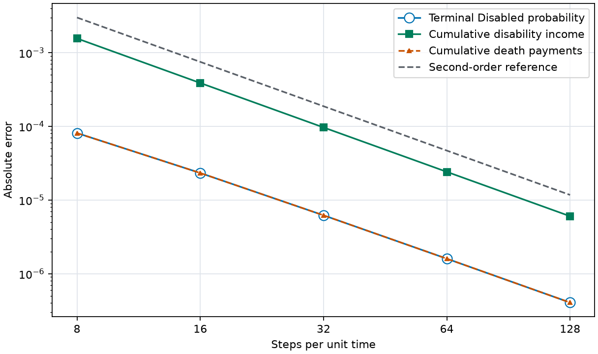

# Solver reading guide

The `jact` solver advances state probabilities and values cashflows over the
same time steps. This guide follows one step of the numerical scheme, then
shows where the implementation saves work. For public inputs and outputs, see
the [API specification](api_spec.md#solver).

## The model we’ll follow

Consider Healthy → Disabled → Dead, starting Healthy. The disability onset
intensity is constant, $a$. The exit intensity from Disabled is $b+cd$,
where $d$ is time since entering Disabled. People who become disabled at
different times therefore have different exit hazards at the same clock time.
We’ll value a unit payment rate while Disabled and a unit lump sum on death.

## What moves along the duration grid

Between transitions, both clock time and time in state increase at unit speed.
A transition resets duration to zero. With step size $h$, the grid represents
durations $0,h,2h,\ldots$. Each slot in the solver’s `density` array stores
**probability mass** at a representative duration. Summing the slots gives
the continuous contribution to state occupancy directly.

Initial probability is stored separately as point masses. An initial point
mass at duration $d_0$ follows $d_0+t$ while it remains in its original
state, preserving any off-grid starting duration. Its outgoing probability
joins the destination’s continuous mass. Total occupancy adds both parts.
[Grid construction and initial carries](../src/jact/solver.py#L2258) ·
[State probability reducer](../src/jact/probability.py#L280)

In the continuous model, let $p_i(t,d)$ be the density away from point masses
and let $P_i(t,\mathrm{d}d)$ include both kinds of mass. For $d>0$, the
transport equation and its inflow boundary are

$$
(\partial_t+\partial_d)p_i(t,d)=-p_i(t,d)\sum_j\mu_{ij}(t,d),
\qquad
p_i(t,0)=\sum_j\int_0^\infty\mu_{ji}(t,d)\,P_j(t,\mathrm{d}d).
$$

The term on the right of the transport equation removes outgoing mass along
each duration path. The boundary condition collects those transfers at
duration zero in the destination state.

## One numerical step

### Sample hazards along the path and advance survivors

For mass $m$ already in state $i$ at duration $d$, sample each outgoing
intensity at the midpoint of its path during the step. Write

$$
H_{ij}=h\,\mu_{ij}(t+h/2,d+h/2),\qquad H_i=\sum_j H_{ij}.
$$

The exponential update leaves $m e^{-H_i}$ in state $i$ and sends

$$
m H_{ij}\,\frac{1-e^{-H_i}}{H_i}
$$

to each destination $j$. The ratio is defined as 1 at zero total hazard.
Survival and all outgoing transfers sum to the starting mass. Surviving grid
mass advances one slot, and a surviving point mass proceeds along its own
duration path. The code evaluates the transfer numerator with `expm1` to
retain accuracy for small hazards.
[Midpoint hazard and duration advancement](../src/jact/solver.py#L404)

### Account for a second transition within the step

Consider the portion of Healthy mass that enters Disabled during the step.
For small $h$, the leading mass that both enters and exits Disabled is
$ab h^2/2$ per unit of starting Healthy mass. Roughly $ah$ enters and
has, on average, half a step in which to exit at leading rate $b$. Delaying
all entrants to the next boundary would omit this second-order contribution
each step and can cause first-order error over a fixed horizon.

The solver sums incoming transfers by destination, then applies the same
competing-risk formula to new entrants with half the integrated hazards from
the destination’s first duration slot. It reuses the existing hazard sample
at $(t+h/2,h/2)$. The surviving entrants go equally into slots 0 and 1,
preserving their total mass and giving them mean representative duration
$h/2$. Probability that makes the second transition joins its new
destination at duration zero. This gives the step its two-transition
correction. [Same-step transfers](../src/jact/solver.py#L733)

### Value cashflows from the same step

- A `StateRate` values existing mass using its midpoint survival and the
  payment rate at the midpoint. It also credits surviving new entrants with
  a half-step payment. The integration weight is in clock time because the
  duration slots already hold probability mass.
  [State-rate contribution](../src/jact/solver.py#L891)
- A `TransitionLump` multiplies the mass transferred on its edge by the
  payment amount. The death benefit in this example includes people who
  entered Disabled and died in the same step.
  [Transition-lump contribution](../src/jact/solver.py#L949)
- `ScheduledEvent` and `DurationEvent` read probability at event snapshots
  using their grid rules. Interval payments use midpoint view weights, and
  events use weights at their effective event time.
  [Event and recording rules](api_spec.md#scheduled-event-policy)

## Check the order of convergence

If disability began at time $s$, survival in Disabled at time $T$ is
$S_D(T-s)$, where $S_D(d)=e^{-bd-cd^2/2}$. Integrating over onset times
gives terminal Disabled occupancy
$P_D(T)=\int_0^T ae^{-as}S_D(T-s)\,\mathrm{d}s$.
Integrating that occupancy over calendar time gives the disability income.
With a unit payment on death, cumulative death payments equal terminal Dead
occupancy, $1-e^{-aT}-P_D(T)$.



The figure uses $a=0.7$, $b=0.2$, $c=0.5$, horizon 2, one individual,
and float64 on CPU. From 64 to 128 steps per unit, the errors shrink by
factors of 3.94 for Disabled occupancy and death payments, and 4.00 for
disability income. The occupancy and death-payment curves coincide because
the Healthy survival update is exact here and the remaining probability
is split between Disabled and Dead.

The repository also checks probability and cashflow convergence against
analytic references. A hazard jump inside a traversed step can lower the
observed order. At fine steps, floating-point rounding can also limit the
observed improvement.
[Probability convergence test](../tests/test_solver.py#L589) ·
[Cashflow convergence tests](../tests/test_cashflows.py#L696) ·
[Numerical contract](api_spec.md#numerical-and-jit-contract)

<details>
<summary>Reproduce the convergence figure</summary>

Run this Python example from the repository root with `jact` and Matplotlib
installed. Set `JAX_PLATFORMS=cpu` before launching Python to use the CPU backend.

```python
from math import erf, exp, pi, sqrt

import jax
import matplotlib.pyplot as plt

import jact

jax.config.update("jax_enable_x64", True)

onset, exit_base, exit_slope = 0.7, 0.2, 0.5
horizon = 2
resolutions = [8, 16, 32, 64, 128]


def integrate_disabled_survival(linear_rate):
    """Integrate exp(-linear_rate * d - exit_slope * d**2 / 2)."""
    scale = sqrt(exit_slope / 2)
    shift = linear_rate / exit_slope
    prefactor = sqrt(pi / (2 * exit_slope))
    prefactor *= exp(linear_rate**2 / (2 * exit_slope))
    return prefactor * (erf(scale * (horizon + shift)) - erf(scale * shift))


healthy_exact = exp(-onset * horizon)
onset_weighted_integral = integrate_disabled_survival(exit_base - onset)
disabled_exact = onset * healthy_exact * onset_weighted_integral
income_exact = (
    integrate_disabled_survival(exit_base)
    - healthy_exact * onset_weighted_integral
)
death_exact = 1 - healthy_exact - disabled_exact

model = jact.Model(
    states=["healthy", "disabled", "dead"],
    transitions={
        ("healthy", "disabled"): lambda t, d: onset,
        ("disabled", "dead"): lambda t, d: exit_base + exit_slope * d,
    },
)
cashflows = model.state_space.cashflows({
    "income": jact.cashflows.StateRate({"disabled": lambda t, d: 1.0}),
    "death": jact.cashflows.TransitionLump({
        ("disabled", "dead"): lambda t, d: 1.0,
    }),
})
views = {
    "income": jact.cashflows.Raw("income", terminal=True),
    "death": jact.cashflows.Raw("death", terminal=True),
}

disabled_errors = []
income_errors = []
death_errors = []
for resolution in resolutions:
    result = model.solve(
        initial="healthy",
        horizon=horizon,
        steps_per_unit=resolution,
        record_every=horizon * resolution,
        cashflows=cashflows,
        cashflow_views=views,
    )
    disabled_index = result.states.index("disabled")
    disabled = float(result.probability[-1, 0, disabled_index])
    income = float(result.cashflows["income"][0])
    death = float(result.cashflows["death"][0])
    disabled_errors.append(abs(disabled - disabled_exact))
    income_errors.append(abs(income - income_exact))
    death_errors.append(abs(death - death_exact))

fig, ax = plt.subplots(figsize=(7.6, 4.5), layout="constrained")
ax.loglog(resolutions, disabled_errors, "o-", color="#0072B2",
          markerfacecolor="white", markersize=9,
          label="Terminal Disabled probability")
ax.loglog(resolutions, income_errors, "s-", color="#007D5A",
          label="Cumulative disability income")
ax.loglog(resolutions, death_errors, "^--", color="#C85200", markersize=4,
          label="Cumulative death payments")
reference = [0.003 * (resolutions[0] / n)**2 for n in resolutions]
ax.loglog(resolutions, reference, "--", color="#5A6068",
          label="Second-order reference")
ax.set_xticks(resolutions, [str(n) for n in resolutions])
ax.set_xticks([], minor=True)
ax.set_xlabel("Steps per unit time")
ax.set_ylabel("Absolute error")
ax.grid(which="major", color="#DFE4EA")
ax.set_axisbelow(True)
ax.legend()
fig.savefig("docs/solver_convergence.png", dpi=160)
```

</details>

## Read `solver.py` in execution order

Start at [`step_scan`](../src/jact/solver.py#L2004), inside `_midpoint_solver`.
For the worked example, follow one individual on one device with `Density()`
as the probability output and all duration limits omitted. That output asks
the solver to retain the duration grids, so the arrays correspond directly to
the numerical steps above.

1. [`_solver_step_dynamics`](../src/jact/solver.py#L640) reads the state at the
   start of the step. Its `_RowHazards` entries are indexed by source state,
   with each outgoing hazard paired with its destination index. It passes
   these rows to [`_compute_same_step_transfers`](../src/jact/solver.py#L733).
2. Read [`_SameStepTransfers`](../src/jact/solver.py#L268) alongside that
   function. `survived_inflow[j]` is the new mass that stays in destination
   `j` and can earn a state-rate payment. `chained_by_source[j]` holds the
   exits by outgoing edge from `j` and feeds transition payments.
   `next_inflow_zero` and `next_inflow_one` collect the mass to deposit in
   those two duration slots for each destination.
3. Follow the same `dynamics` tuple into
   [`_state_rate_contribution`](../src/jact/solver.py#L891) and
   [`_transition_lump_contribution`](../src/jact/solver.py#L949) to see the two
   payment formulas. Then follow it into
   [`_advance_solver_step_from_dynamics`](../src/jact/solver.py#L809), which
   produces the probability carry for the next step. The formulas can be read
   directly in those helpers. [`_compute_cashflow_step`](../src/jact/solver.py#L1004)
   handles dispatch, shared cores, events, and aggregation around them.
4. Return to `block_scan` and read the [recording code](../src/jact/solver.py#L2080).
   Probability is a snapshot after the block. Streamed cashflows
   sum payments within the block, while terminal totals carry forward across
   blocks.

For the full call path, start at the [`solve` implementation](../src/jact/solver.py#L2930)
below the overloads. It validates the inputs, reduces the model, builds the
initial carries and grids, and binds cashflow views. [`_run_midpoint_solver`](../src/jact/solver.py#L2591)
chooses single-device or sharded execution before reaching the kernel.

## Where the solver saves work

The public `solve()` prepares a reduced model and its cashflow attachments.
The compiled kernel then runs an inner scan over numerical steps and an
outer scan over recording intervals. `record_every` controls how often
outputs are emitted. Each inner step still advances probability and values
interval cashflows, and terminal views accumulate without storing a time
series. During reverse-mode differentiation, the solver can recompute one
recording block at a time to avoid retaining every inner step.
[Solve setup](../src/jact/solver.py#L3005) ·
[Nested scans](../src/jact/solver.py#L1994)

| Optimization | Work saved and when it applies | Where to read |
| --- | --- | --- |
| Reachable-state reduction | Drops states and transitions outside the subgraph reachable from the declared initial states. | [Reduction contract](api_spec.md#reduction), [closed-form comparison](../tests/test_solver.py#L773) |
| Empty duration grids | With eligible outputs, a state without incoming transitions needs no evolving continuous grid. Its initial point mass still evolves and earns payments. | [Grid planning](../src/jact/solver.py#L2437), [full-grid comparison](../tests/test_empty_density_states.py#L18) |
| Duration marginals | Tracks a continuous total for eligible absorbing states and for states whose relevant intensities and payments broadcast over duration. Duration-resolved output and duration events can require the grid. Shape checks happen during JIT tracing. | [Uniformity planner](../src/jact/solver.py#L1620), [absorbing-state comparison](../tests/test_absorbing_states.py#L34), [uniform-state comparison](../tests/test_uniform_duration_states.py#L45) |
| Derived-field reuse | Shares field values across consumers in the same evaluation context and hoists reusable duration-only work on fixed grids. Point-mass durations still change with time. | [Derived-field notebook](derived_fields_notebook.ipynb), [hoisting test](../tests/test_derived.py#L423) |
| Named payment cores | Integrates a declared payment core once for compatible uses, then applies each use’s duration-independent weight. | [Sharing rules](api_spec.md#named-payment-cores), [comparison with unfactored payments](../tests/test_scaled_cashflows.py#L91) |
| Per-destination transfers | Accumulates transfers directly by destination and advances point masses per state. This reduces scatter and packing work in the compiled step. | [Transfer code](../src/jact/solver.py#L733), [release history](../CHANGELOG.md#0117) |

Duration limits are a separate modelling choice. Intensity and payment
limits cap the duration seen by their callables. Probability compression
merges older continuous cohorts at a fixed representative duration. All
three can change results, so compare the probabilities and cashflows you
intend to use against an unlimited solve at the same step size.
[Duration-limit approximations](jact_duration_approximations.md)

## Read the performance evidence

The end-to-end benchmark measures warmed solves and synchronizes the result
before stopping the timer. For a new comparison, record the backend and
device, dtype, batch size, horizon, step size, probability output and
cashflow views. If first-call cost matters, measure it separately.
[End-to-end benchmark](../benchmarks/benchmark_solver_kernel.py)

The duration-limit study reports runtime, carry size and approximation error
together. In its 20-unit, expensive-callable CPU case, enabling all three
limits reduced median time from 720.6 ms to 196.6 ms and the reported carry
from 7,728 to 912 bytes. The maximum terminal cashflow difference was 6.64
in the example’s payment units. The same study includes workloads where
some limits made execution slower. [Settings and measurements](duration_limit_benchmark.md)
